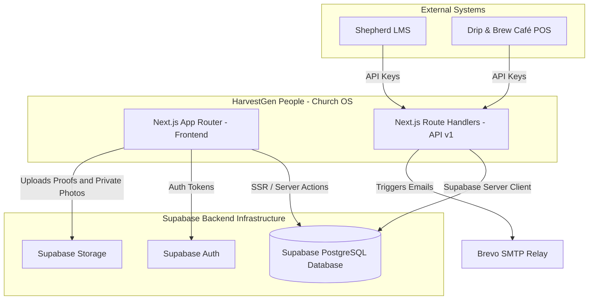
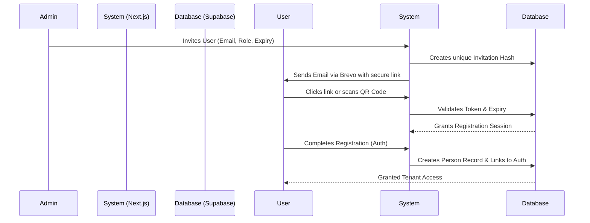
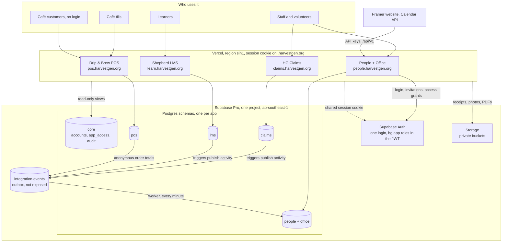
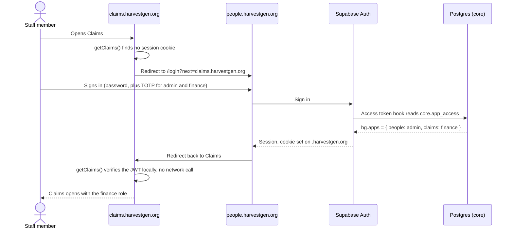
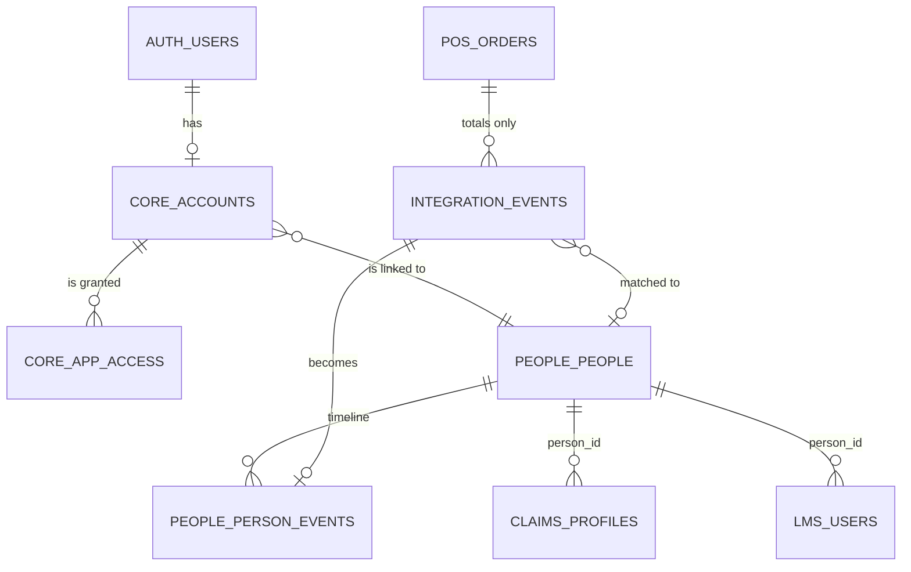
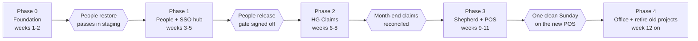

# HarvestGen People

People is a comprehensive, multi-tenant church member relationship management system built for Harvest Generation Church. It serves as the central source of truth for all member data, offering a secure, tenant-isolated environment. It seamlessly integrates with external connected systems—such as the Shepherd Learning Management System (LMS) and Drip & Brew Café Point-of-Sale (POS)—via a robust REST API authenticated by securely managed API keys.

> **Where this is heading:** People is becoming the single sign-in and member-data hub for all HG systems, in one shared Supabase project. See [HG Platform](#-hg-platform-people-as-the-hub-for-every-hg-system) for the target architecture and the phases to get there.

**Tech Stack:** Next.js 16 (App Router), React 19, TypeScript, Tailwind CSS, shadcn/ui, Supabase (Postgres + Auth + Storage), Sharp (server-side image processing), Brevo (Transactional Email).

---

## 🏛️ System Architecture

HarvestGen People operates on a decoupled client-server model wrapped in a full-stack Next.js application, utilizing Supabase for a heavily secured Backend-as-a-Service architecture.

### High-Level System Context (today)



### Authentication & Invitation Flow

The platform relies on a strict, invite-only onboarding process to guarantee data security. 



---

## 🧭 HG Platform: People as the hub for every HG system

People is becoming the sign-in and member-data hub for all Harvest Generation systems.
HG Claims, Shepherd (LMS), Drip & Brew POS and a new Office dashboard will move into
**one Supabase Pro project**, each in its own Postgres schema. Everyone signs in once,
at People.

| | |
| --- | --- |
| **Status** | Planned. Phase 0 not started. The combined migrations are ready in [`platform/`](platform/README.md). |
| **Design** | [HG Platform Architecture Proposal](https://claude.ai/artifact/Cud54DziBpWp48jFgXG7Az) |
| **Jira** | Search `labels = hg-platform`. Epics: [KAN-18](https://harvestgen.atlassian.net/browse/KAN-18), [KAN-19](https://harvestgen.atlassian.net/browse/KAN-19), [HC-1](https://harvestgen.atlassian.net/browse/HC-1), [DMD-13](https://harvestgen.atlassian.net/browse/DMD-13), [DB-7](https://harvestgen.atlassian.net/browse/DB-7), [KAN-20](https://harvestgen.atlassian.net/browse/KAN-20) |

### Why

| Today | Target |
| --- | --- |
| 4 Supabase projects in 4 places, 2 GitHub owners, apps on Vercel in several accounts | 1 Supabase Pro project in Singapore, 1 GitHub org, 1 Vercel team pinned to `sin1` |
| 4 logins, 4 user tables, 4 role systems | 1 login at People; app roles carried in the session token |
| The same person stored separately in each app | One person record in People; other apps refer to it by `person_id` |
| No Vercel region set, so database calls likely cross the Pacific | Apps and database both in Singapore |
| People's server code mostly uses the service role, so RLS is bypassed | RLS enforces access; service role only for invitations, cron, webhooks and the event worker |

### Target architecture



Each app reads and writes only its own schema, plus read-only views in `core`. Apps never
call each other: they publish to the outbox, and People turns that into each person's
timeline. Drip & Brew customers stay anonymous. Only order totals leave the POS, for
Office reporting.

### Signing in across apps



Role changes take effect on the next token refresh, about an hour. Revoking all access in
People signs the user out everywhere at once. Claims keeps its stricter rule: approving
or paying needs a sign-in within the last 60 minutes (step-up re-authentication).

### Database layout

| Schema | Owner | Main tables (live) | Exposed to API |
| --- | --- | --- | --- |
| `core` | People | `accounts`, `app_access`, `app_roles`, `audit_log`, `person_directory` view (to build) | Yes |
| `people` | People | `people`, `households`, `events`, `event_registrations`, `workflows`, `workflow_steps`, `workflow_cards`, `tags`, `lists`, `connect_forms`, `webhooks`, `webhook_deliveries`, `api_keys`, `church_memberships` (37 tables) | Yes |
| `office` | People (`/office`) | To be decided | Yes |
| `claims` (+ `claims_private`) | HG Claims | `claims`, `claim_expenses`, `claim_attachments`, `expense_categories`, `ministries`, `ministry_budgets`, `reimbursement_batches`, `reimbursement_batch_instructions`, `reimbursement_instruction_claims`, `payments`, `recurring_payments`, `profiles` (31 tables) | Yes |
| `lms` (+ `lms_private`) | Shepherd | `users`, `modules`, `module_versions`, `learner_progress`, `curriculum_sessions`, `session_attendances`, `teacher_assignments`, `reminder_deliveries`, `whatsapp_logs`, `admin_permissions` (16 tables) | Yes |
| `pos` | Drip & Brew | `products`, `orders`, `order_items`, `promo_codes`, `inventory_items`, `inventory_logs`, `settings` (8 tables) | Yes |
| `integration` | Platform | `events` outbox (to build) | No |



`person_id` links (Claims profiles, Shepherd users) and the `core` tables are added during
the phases below; they don't exist yet. POS orders never link to a person.

### Phases



Timings assume one or two part-time developers. Each phase starts only when the previous
gate passes.

#### Phase 0: Foundation ([KAN-18](https://harvestgen.atlassian.net/browse/KAN-18))

Set up the shared project and the identity layer every app depends on.

- [ ] Supabase Pro project in `ap-southeast-1`, plus a staging project (KAN-21)
- [ ] App schemas, API exposure and grants (KAN-22). Done in [`platform/`](platform/README.md); apply after review.
- [ ] `core.accounts`, `core.app_access`, `core.app_roles` (KAN-23)
- [ ] Access token hook putting app roles in the JWT; asymmetric signing keys (KAN-24)
- [ ] Shared `core.audit_log` (KAN-25)
- [ ] All repos in HarvestGen-Dev, one Vercel team, region `sin1` (KAN-26)
- [ ] Decide: monorepo or separate repos (KAN-27)
- [ ] `@hg/auth` package: shared cookie, `getClaims`, `can()` (KAN-28)
- [ ] `@hg/ui` package: header, app switcher, tables, forms (KAN-29)
- [ ] Auth hardening: invite-only, MFA for admin and finance, Brevo SMTP (KAN-30)
- [ ] CI checks for shared-database migrations (KAN-31)
- [ ] `integration.events` outbox and `core.person_directory` view (KAN-32)

#### Phase 1: People becomes the hub ([KAN-19](https://harvestgen.atlassian.net/browse/KAN-19))

Move People into the shared project, let RLS do the access control, and make People the
only login.

- [ ] Move the People database and Storage into the `people` schema (KAN-33)
- [ ] Move People accounts and memberships into shared Auth and `core.app_access` (KAN-34)
- [ ] Use the user's session client instead of the service role in read/write paths (KAN-35)
- [ ] One permission map instead of scattered role checks (KAN-36)
- [ ] `getClaims()` in `proxy.ts`; roles from the JWT, not per-request queries (KAN-37)
- [ ] Cache stable reference data; stream slow panels (KAN-38)
- [ ] Harden `/api/v1` key checks: narrow select, cache, rate limit (KAN-39)
- [ ] Single-church build: remove multi-tenant UI and code (KAN-40)
- [ ] Shared-cookie login for all HG apps (KAN-41)
- [ ] App launcher home page (KAN-42)
- [ ] Access tab on each person: grant and revoke app roles (KAN-43)
- [ ] Event worker for the outbox (KAN-44)
- [ ] Shepherd and Claims activity on the person timeline (KAN-45)
- [ ] Command palette and repo clean-up (KAN-46)

#### Phase 2: HG Claims ([HC-1](https://harvestgen.atlassian.net/browse/HC-1))

- [ ] Move the Claims database and receipts into the `claims` schema (HC-2)
- [ ] Merge Claims accounts into shared Auth; roles into `core.app_access` (HC-3)
- [ ] People sign-in and claims-based middleware (HC-4)
- [ ] Replace the 1-hour session with step-up re-auth for approve and pay (HC-5)
- [ ] Bank-detail encryption keys in Supabase Vault (HC-6)
- [ ] Publish claim activity to the outbox; audit into `core.audit_log` (HC-7)

#### Phase 3: Shepherd and Drip & Brew ([DMD-13](https://harvestgen.atlassian.net/browse/DMD-13), [DB-7](https://harvestgen.atlassian.net/browse/DB-7))

- [ ] Move the Shepherd database and PDFs into the `lms` schema (DMD-14)
- [ ] Merge Shepherd users into shared Auth; link every learner to a person (DMD-15)
- [ ] People sign-in replaces Shepherd login and OTP (DMD-16)
- [ ] Learner enrolment through the People portal (DMD-17)
- [ ] Publish enrolment, completion and attendance to People (DMD-18)
- [ ] Move the Drip & Brew database and edge functions into the `pos` schema (DB-8)
- [ ] Per-device till accounts with a staff PIN; People sign-in for managers (DB-9)
- [ ] Customers stay anonymous; only order totals to the outbox (DB-10)
- [ ] Keep the Planning Center push working after the move (DB-11)

#### Phase 4: Office and retiring the old projects ([KAN-20](https://harvestgen.atlassian.net/browse/KAN-20))

- [ ] `office` schema, role and `/office` section in People (KAN-47)
- [ ] Decide the Office dashboard's first three features (KAN-48)
- [ ] Review compute size and point-in-time recovery after a month of shared load (KAN-49)
- [ ] Retire the four old Supabase projects and Vercel deployments (KAN-50)

### Decisions

| Decision | Status | Where |
| --- | --- | --- |
| People serves Harvest Generation only (single-church build) | Decided 24 Nov 2026 | KAN-40 |
| Drip & Brew customers have no logins or People profiles; checkout unchanged | Decided 24 Nov 2026 | DB-10, DB-11 |
| Office dashboard lives inside People at `/office` | Decided 24 Nov 2026 | KAN-47 |
| Monorepo or separate repos | Open | KAN-27 |
| Office dashboard features | Open, deferred | KAN-48 |
| Compute size and point-in-time recovery add-on | Open, after the first month | KAN-49 |

### What changes for People developers

- **Two Supabase folders.** `supabase/` is today's People-only project and still deploys as
  before. `platform/supabase/` is the shared project. Add new People migrations to
  `supabase/` until the Phase 1 cutover, then regenerate `platform/` (see
  [platform/README.md](platform/README.md)).
- **Schema-scoped client.** After cutover, People's Supabase client uses
  `{ db: { schema: 'people' } }`.
- **RLS first.** New server code uses the signed-in user's client. Only modules under
  `src/lib/server/privileged/` may use the service role.
- **Roles come from the token.** Read them with `getClaims()` and `can()` from `@hg/auth`,
  not by querying `church_memberships` on each request.

---

## 🚀 Getting Started

### Prerequisites

Before you begin, ensure you have the following installed:
- [Node.js](https://nodejs.org/en/) (v20 or higher recommended)
- [Docker Desktop](https://www.docker.com/products/docker-desktop/) (must be running in the background)
- [Supabase CLI](https://supabase.com/docs/guides/cli/getting-started) (`brew install supabase/tap/supabase` on Mac)

### 1. Environment Setup

Copy the example environment file to create your local `.env` configuration files. Both `.env` and `.env.local` are used to ensure smooth Docker builds and Next.js development.

```bash
cp .env.example .env.local
cp .env.example .env
```

*Note: For email functionality (Invitations), you must provide `BREVO_SMTP_USER` and `BREVO_SMTP_KEY` in your environment files.*

### 2. Start the Local Supabase Infrastructure

Use the Supabase CLI to spin up the local database, auth services, and storage buckets via Docker:

```bash
supabase start
```
*This command will output your local API keys, Studio URL, and Postgres URL. Ensure the `NEXT_PUBLIC_SUPABASE_URL` and `NEXT_PUBLIC_SUPABASE_ANON_KEY` match the values generated in your `.env.local` file.*

### 3. Install Dependencies

```bash
npm install
```

### 4. Run the Development Server

To start the Next.js development server with Hot Module Replacement (HMR):

```bash
npm run dev
```

Open [http://localhost:3000](http://localhost:3000) in your browser.

---

## 🐳 Running Locally via Docker (Production Simulation)

To run the application exactly as it would behave in a production environment, we use a highly optimized, multi-stage Docker build.

1. **Build the Docker Image**
   This compiles the Next.js app and strips away unnecessary files (like the massive `node_modules` folder) to create a lightweight container.
   ```bash
   docker build -t people-hg .
   ```

2. **Run the Docker Container**
   ```bash
   docker run -p 3000:3000 people-hg
   ```
   The app will be available at [http://localhost:3000](http://localhost:3000).

> **Important Note on Environment Variables:** 
> Next.js "bakes" `NEXT_PUBLIC_` environment variables into the frontend bundle during the build step (`npm run build`). For local Docker testing, the `Dockerfile` automatically reads your local `.env` file so the container can connect to your local Supabase instance. When deploying to production (e.g., Vercel, AWS), you must configure the production environment variables in your hosting provider's dashboard before building.

---

## 🛡️ Testing & Verification

With Docker and the local Supabase stack running, execute the same release verification gate used by CI to ensure code health:

```bash
npm run verify
```

This runs:
- TypeScript type checking (`tsc --noEmit`)
- Code linting (`eslint`)
- Unit tests for HG Link schemas and validation (`npm run test:unit`, needs Node 22.6+)
- Supabase schema linting and Postgres validation
- Node.js native Integration tests (Account Onboarding, People Lookup, Event Registration, Webhooks, People Photos)
- A simulated Next.js production build

People-photo upload tests require the local Supabase stack and exercise the
private `people-photos` bucket, server-side WebP processing, signed URL
authorization, portal restrictions, and replacement cleanup.

### HG Link

HG Link (public connections hub at `/link`, edited under **Settings → HG Link**) is
part of this app. Set `HG_LINK_CHURCH_SLUG` to serve a church at `/link`; every church
is also reachable at `/link/<church-slug>`. See [docs/HG_LINK.md](docs/HG_LINK.md).

---

## 📖 Architecture Rules & Guidelines

When contributing to this project, please adhere to the rules established in:
- `SPEC.md`: Outlines the API endpoints, database schema, and design system.
- `GEMINI.md`: Core engineering rules for Supabase SSR, App Router conventions, and strict TypeScript usage.
- `AGENTS.md`: Outlines the specific roles (Architect, Backend, Frontend, DevOps) for maintaining separation of concerns in prompt-driven development.
